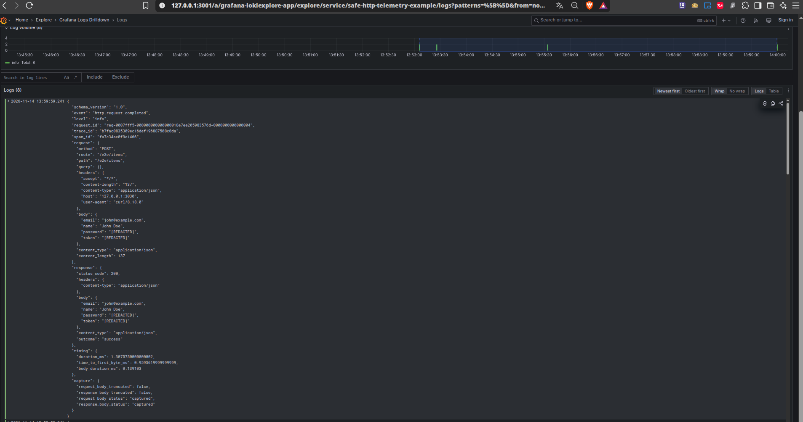
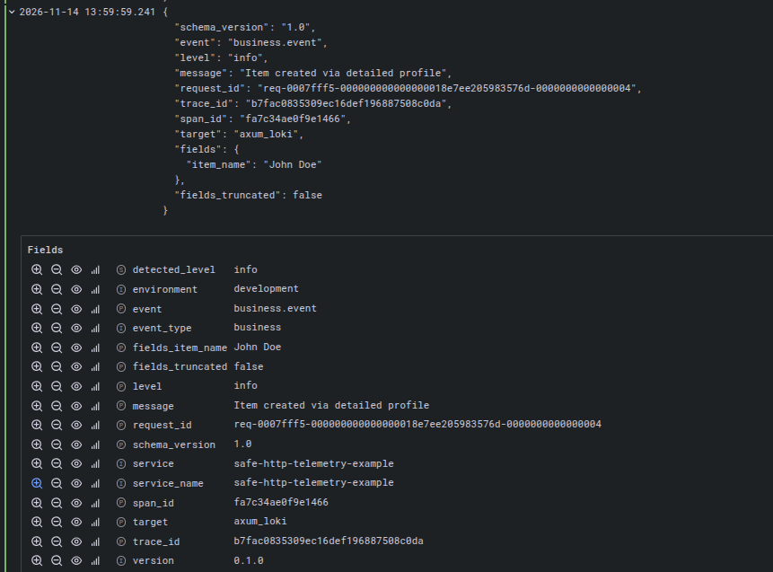

# safe-http-telemetry

Bounded HTTP telemetry for Rust services using Axum or Tower, with optional `tracing` business events, OpenTelemetry correlation, Grafana Loki export, and local IP geolocation.

> **Release status:** `0.1.0` is published. This repository is preparing `0.1.1`; its installation commands become available after that version is published. The minimum supported Rust version is **1.85.0**.

## Why this project

HTTP telemetry is useful for understanding request failures and latency, but collecting it safely is not just a matter of logging every request. Middleware that copies arbitrary paths and payloads can expose identifiers, credentials, or personal data. Synchronous exporters can add backend latency to application requests, while unbounded queues can turn a telemetry outage into an application memory problem.

`safe-http-telemetry` addresses these concerns in one integration: capture is opt-in by route, data is bounded and redacted before it enters the queue, and export runs outside the request path. It gives Rust services a consistent HTTP event model and a controlled path from middleware to Loki, while leaving server setup, telemetry retention, access control, and OpenTelemetry span export under application control.

## What it does

- Observes the HTTP lifecycle without waiting for Loki on the request path. Each event records a generated request ID, method, normalized route, status, outcome, and duration.
- Applies route-specific `Minimal`, `Standard`, or `Detailed` capture policies. Query, header, and optional body capture have explicit size limits and sensitive-field redaction before enqueueing.
- Places events in a bounded queue. A full queue drops the newest event and increments operational counters; it does not block the application request.
- Exports bounded batches to Loki with fixed workers, bounded retries, and a graceful drain deadline. The same queue can receive redacted application events from a `tracing` layer.
- Correlates HTTP and business events with W3C trace context when `opentelemetry` is enabled. **Span export is configured by the application**; the included example does not send spans to a tracing backend.
- Optionally looks up an IP in a local MMDB file. The crate does not bundle or download a production database.

The library contains no server binary. The [minimal example](examples/minimal_axum.rs) prints redacted events as JSON; the [Loki example](examples/axum_loki.rs) shows the complete queue, subscriber, exporter, and shutdown wiring.

## Loki in action

These screenshots are from the local Axum and Loki example and use fictitious data. The HTTP event keeps the demonstration name and email while redacting the configured `password` and `token` fields. The business event shows service labels and request/trace identifiers.





## Try it locally

From this repository, with Rust 1.85 or newer:

```sh
cargo run --locked --example minimal_axum --features axum,tracing
```

In another terminal:

```sh
curl http://127.0.0.1:3030/hello/example
curl http://127.0.0.1:3030/health
```

The first request produces a JSON HTTP event in the server terminal. `/health` is excluded. Press Ctrl+C to stop the server and drain the example's queue. No Loki or database is needed.

For a complete local Loki walkthrough, including a query that finds both HTTP and business events, use the [examples guide](examples/README.md).

## Add and integrate the crate

The default feature set is empty. Add only the integrations you plan to use. These commands target `0.1.1` and will work after that release is available on crates.io.

### 1. Install minimal Axum telemetry

From your application directory:

```sh
cargo add safe-http-telemetry@0.1.1 --features axum,tracing
cargo add axum tracing tracing-subscriber serde_json
cargo add tokio --features macros,net,rt-multi-thread,signal
```

`cargo add` writes the dependencies and feature selections to `Cargo.toml`. If your application already uses Axum, Tokio, or tracing, keep its existing entries and add only the missing features.

### 2. Create one queue, a route policy, and the Axum layer

Add the following wiring to your application startup. The full runnable source is [`minimal_axum.rs`](examples/minimal_axum.rs).

```rust
use axum::{routing::get, Router};
use safe_http_telemetry::{
    axum_adapter::axum_telemetry_layer,
    core::telemetry::InternalTelemetry,
    policy::{CaptureProfile, RoutePattern, RoutePolicy, RoutePolicySet},
    runtime::queue::{BoundedEventQueue, QueueConfig},
    tower_integration::MiddlewareConfig,
};

let queue = BoundedEventQueue::new(QueueConfig::new(128), InternalTelemetry::new())?;
let mut policies = RoutePolicySet::new(CaptureProfile::Minimal);
policies.add_policy(
    RoutePolicy::new(RoutePattern::exact("/health"), CaptureProfile::Minimal).exclude(),
)?;
let telemetry_layer =
    axum_telemetry_layer(queue.clone(), policies, MiddlewareConfig::default())?;

// Register routes before applying the layer so Axum can provide MatchedPath.
let app = Router::new()
    .route("/hello/{name}", get(|| async { "Hello from safe HTTP telemetry" }))
    .route("/health", get(|| async { "OK" }))
    .layer(telemetry_layer);
```

The layer submits completed events to the bounded queue; it does not choose a destination. A queue must have one consumer. For a local smoke test, the [minimal example](examples/minimal_axum.rs) prints JSON events. In a deployed service, use a durable sink such as the Loki exporter below. On shutdown, stop the HTTP server gracefully, close the queue, and wait for its consumer or exporter to drain.

### 3. Connect the queue to Loki (optional)

For the complete Loki, business-event, OpenTelemetry, and shutdown setup, enable these features and add the direct dependencies used by your application code:

```sh
cargo add safe-http-telemetry@0.1.1 --features axum,loki,tracing,opentelemetry
cargo add axum opentelemetry opentelemetry_sdk tracing tracing-opentelemetry tracing-subscriber
cargo add tokio --features macros,net,rt-multi-thread,signal,sync,time
```

Use `serde` with its `derive` feature if your handlers deserialize application payloads. The complete [`axum_loki.rs`](examples/axum_loki.rs) demonstrates how to:

1. Create one shared bounded queue and redactor.
2. Configure a `BusinessLogLayer` and tracing subscriber if application events are needed.
3. Read the Loki URL, tenant, and bearer token from deployment configuration or secrets.
4. Start one `LokiExporter` and pass the queue to the Axum layer.
5. Shut down Axum, the tracer provider, and the exporter in order; inspect the export shutdown report.

Use HTTPS for a remote Loki endpoint and keep bearer tokens out of URLs. Run the [examples guide](examples/README.md) and the [production guide](docs/production.md) before deploying.

### 4. Enable optional capture only where needed

`body-capture` permits bounded request and response body observation on explicitly selected `Detailed` routes. Add it only if your service needs this data:

```sh
cargo add safe-http-telemetry@0.1.1 --features axum,loki,tracing,opentelemetry,body-capture
```

This feature list assumes the Loki setup above; keep whichever existing features your application needs and add `body-capture` to that list.

The `geolocation` feature requires a separately obtained, licensed MMDB file and an explicit path; the crate does not download or bundle a production database. See the [geolocation guide](docs/geolocation.md).

Start with `Minimal`. Review each `Detailed` route, add domain-specific sensitive field names to `RedactionConfig`, and test redaction with fictitious payloads. Raw URL paths are omitted from middleware events (`request.path` is `[OMITTED]`); normalized route templates remain. The [capture policy](docs/policies.md) and [redaction](docs/redaction.md) guides explain the limits and trust boundaries.

## Feature flags

Default features are empty. Enable only the integrations you need.

| Feature | Purpose |
| --- | --- |
| `tower` | HTTP middleware for Tower services |
| `axum` | Axum adapter and normalized `MatchedPath` routes; enables `tower` |
| `tracing` | Redacted application-event layer for a `tracing` subscriber |
| `opentelemetry` | W3C trace-context correlation; enables `tracing` |
| `loki` | Asynchronous Loki exporter and bounded retry configuration |
| `body-capture` | Bounded request and response body observation for `Detailed` policies |
| `geolocation` | Country lookup from an explicitly supplied local MMDB path |

The [capture policy guide](docs/policies.md) describes the three profiles. The [redaction guide](docs/redaction.md) describes supported formats and limits.

## Production boundaries

- Set queue capacity, capture limits, Loki batch limits, retry timeout, and shutdown deadline for your workload. Monitor `InternalTelemetry::snapshot()` for drops and export failures. See the [production guide](docs/production.md).
- Forwarded client-IP headers are ignored unless the immediate peer belongs to your configured trusted proxy CIDRs. Request IDs supplied by clients are not trusted by default.
- Loki labels have controlled cardinality. Request IDs, IPs, paths, and payload values remain outside indexed labels. Limit access to Loki even when redaction is enabled.
- Supply Loki credentials through deployment secrets. The example reads `LOKI_BEARER_TOKEN` and optional `LOKI_TENANT_ID`; it never puts credentials in the URL.
- With `geolocation`, deploy a separately licensed MMDB file and configure `GeolocationConfig::new(path)`. See the [database guide](docs/geolocation.md) for pinned downloads, attribution, Docker mounts, and updates.
- The repository's Docker Compose stack binds Loki and Grafana to loopback for local evaluation. It is not a hardened production deployment.

## Possible next steps

The current focus is a small, dependable core for Axum and Tower services. Future work may explore:

- Additional framework adapters if there is demonstrated user demand.
- A documented metrics-export example for the internal queue and exporter counters.
- More compatibility guidance and migration support as the event schema evolves.
- Continued performance and memory measurements across capture profiles and exporter load.

These are areas for exploration, not a release schedule. The project wiki tracks the current roadmap and status.

## Documentation and support

The [project wiki](https://github.com/sylvainTIASSOU/safe-http-telemetry/wiki) tracks current status, roadmap, integration, architecture, and operations.
The published [API reference on docs.rs](https://docs.rs/safe-http-telemetry/latest/safe_http_telemetry/) includes the crate guide and module documentation.

| Guide | Covers |
| --- | --- |
| [Examples](examples/README.md) | Commands, configuration variables, test requests, Loki queries, cleanup |
| [Axum integration](docs/axum.md) | Middleware placement, queue ownership, request IDs, errors, shutdown |
| [Grafana and tracing](docs/grafana-opentelemetry.md) | Subscriber wiring, trace IDs, LogQL, span-export boundary |
| [Production configuration](docs/production.md) | Limits, redaction, proxies, resilience, monitoring |
| [Geolocation](docs/geolocation.md) | External MMDB distribution and licensing |
| [Test and release matrix](docs/test-matrix.md) | Automated checks, external checks, release gates |
| [Migration](docs/migration.md) and [compatibility](docs/semver.md) | API changes and MSRV policy |

Report bugs or integration questions in [GitHub issues](https://github.com/sylvainTIASSOU/safe-http-telemetry/issues). The source is licensed under [MIT](LICENSE-MIT); optional external databases and the synthetic test fixture have their own terms in [third-party notices](THIRD_PARTY_NOTICES.md).

## Verify a checkout

```sh
cargo fmt --all -- --check
cargo test --locked --all-targets --all-features
cargo clippy --locked --all-targets --all-features -- -D warnings
RUSTDOCFLAGS='-D warnings' cargo doc --locked --no-deps --all-features
cargo +1.85.0 test --locked --all-targets --all-features -j 1
python3 -m unittest discover -s scripts -p 'test_*.py'
```

The real Loki tests and fuzz targets are described in the [test matrix](docs/test-matrix.md). Publication readiness is checked with `cargo publish --dry-run --locked --all-features` and a fresh `cargo package --locked --no-verify` archive inspection.
